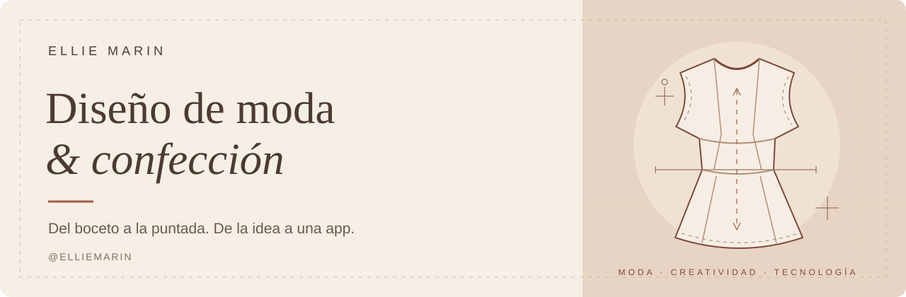

  

## Hola, soy Ellie ✂️

Me dedico al **diseño de moda y la confección**. Quiero conectar ese mundo con la tecnología y darle forma a una idea: **crear una app relacionada con la moda y la confección**.

### Mi próximo proyecto

Estoy en la etapa de idea de una app para este ámbito. Este perfil será el espacio donde compartiré su evolución, desde el concepto hasta los primeros avances.

### El hilo conductor

- **Diseño de moda:** el punto de partida.
- **Confección:** llevar las ideas a la prenda.
- **Tecnología:** explorar nuevas posibilidades a través de una app.

---

<em>Del boceto a la puntada. De la idea a una app.</em>

